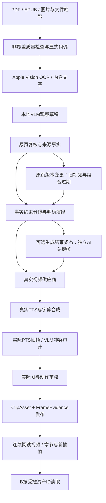

# A侧架构、Trace与复现边界

这些是有明确职责与输入输出的工程节点，VLM和TTS是实际本机模型调用；没有把多个函数虚称为多个自主大模型Agent。

服务与单个工作进程分开，SQLite保存任务、历史和资产元数据；工作进程使用文件锁。API只监听本机回环地址，不提供公网多用户鉴权。视频生成可以离线预生成，不应在B的每次伴读交互中重新执行。

## 显式流水线与恢复

`POST /v1/pipelines` 接收已审核的`shot_id`及幂等键，`POST /v1/pipelines/{id}/advance`推进一个节点：VideoGeneration → TTS/Render → FrameValidation → ActualFrameReview → Publish。反复调用不重复创建正在执行的节点；失败状态停止，审核阶段不会自动生成观察或自动发布。

可使用`resume_run_ids`接入已有真实视频、配音、审计任务；任务类型、原始分镜和上游片段引用必须一致。更换原页版本或分镜输入会使流水线过期。CLI见`scripts/advance_pipeline.py`，它只连接本机服务。

原始导入、质量、OCR、页面理解与分镜通过各自接口和审核门衔接。图文修订保留原始模型输出及版本历史；观察草稿不能自动进入已确认事实。正文改动与事实/角色改动会使受影响视频和连续视频的旧证据失效。

## 复现的三种不同承诺

1. 原产物校验：恢复交付包后，校验素材、原视频、音频、帧与字幕SHA256。这是字节级核验。
2. 配置复跑：固定运行库、权重版本、种子、提示词、输入与参数，发起新的实际推理；保留新的任务与结果记录。
3. 像素一致：没有承诺跨Metal版本、机型、并行内核或模型库更新后逐像素相同。相同seed不等于所有环境必然输出相同媒体。

已知云任务恢复不重新提交；提交是否受理不明确时禁止自动重投。本地任务中断保留日志，不能把失败记录重写成成功。结束关键帧改变也改变本地输入指纹，不能覆盖旧参考证据。

## 交接自测

`scripts/contract_consumer.py`不导入A内部模块，仅通过HTTP获取manifest、片段和实际帧，检查Range、媒体哈希、时间码与重新解码的像素一致性。这是A侧独立消费者测试，不能冒充B已接入或团队验收。
